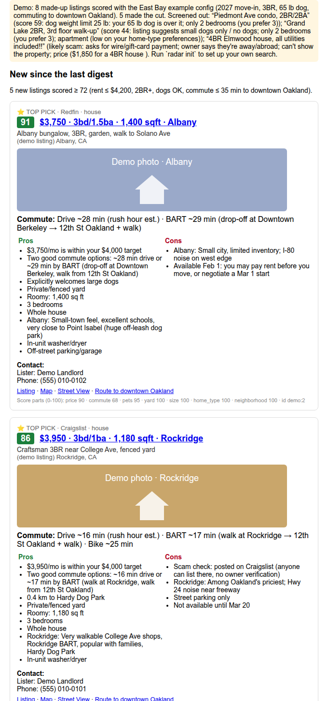

# Rental Radar 🏠📡

**Stop refreshing rental sites. Let the good listings come to you, and leave the scams behind.**

Rental Radar is a small, self-hosted program that searches for a rental for you around the clock.
Every hour it pulls listings from Craigslist, Redfin, Realtor.com, local property-management companies
and your Zillow/HotPads/Trulia saved-search alerts. It scores each one against what *you* care
about: budget, commute, bedrooms, yard, pets, the neighborhoods you love and the ones you don't. It
checks each listing for the tell-tale signs of rental fraud, and then sends you the best ones by
email, Discord, Slack, Telegram or phone push notification (ntfy):

- ⭐ **Top-pick alerts within the hour** when something great appears, because good places go fast.
- 📬 **A daily digest** with every new match, plus a running "top 20 still available" shortlist.
- ⚠️ **Scam retractions** if something it already sent you later turns out to be fake.

Every listing comes with a plain-English **pros and cons** list ("Private fenced yard", "Dog weight
limit 40 lb: your 65 lb dog is over it", "Only 2 bedrooms (you prefer 3)"), the commute by car and by
transit, the lister's contact details, and one-click Map / Street View / route links.

It was built for a real cross-country move, searching remotely for a family home with a big dog. Along
the way it caught two convincing scams: a fake street number pasted onto a just-sold home's listing,
and a withdrawn for-sale listing reposted as a rental at half the going rent. It has since been turned into a
general tool that works anywhere in the US.

<p align="center"></p>

See it on your own machine in ten seconds, with no setup: `radar demo` scores a handful of made-up
listings and opens the email in your browser (`radar demo --chat` also prints the Discord/ntfy
version).

## Why it's different

| | Typical listing-site alerts | Rental Radar |
|---|---|---|
| Sources | One site | Craigslist, Redfin, Realtor.com, property-manager portals, and alert emails from Zillow, HotPads, Trulia, Apartments.com, Zumper and more, de-duplicated |
| Ranking | Newest first | A 0–100 score from *your* weighted priorities, with the reasons spelled out |
| Commute | Distance as the crow flies | Rush-hour driving (OSRM road routing), plus optional train/metro trips modeled station by station |
| Neighborhoods | None | Your own ratings and notes, with avoid/favorite lists |
| Pets | "Pets allowed" checkbox | Reads weight limits, "small dogs only", pet rent and deposits from the text |
| Scams | Up to you | Fake-address check, a sale-history index that remembers withdrawn listings, copied-description detection, rent-vs-home-value check, a dozen weighted warning signs, and retraction emails |
| Privacy | Your search lives on their servers | Runs on your machine. No accounts, no API keys, no telemetry |

## Quick start

Requirements: Python 3.11+, Linux or macOS (Windows via WSL), and a search area in the US.

```bash
uv tool install git+https://github.com/jacotay7/rental-radar   # or: pipx install git+https://github.com/jacotay7/rental-radar
radar demo                 # see what you'll get (made-up listings, nothing to configure)

mkdir -p ~/my-search && cd ~/my-search
radar init                 # 2-minute wizard: destination, budget, beds, pets, move-in
$EDITOR .env               # where results go: paste a Discord/Slack/ntfy webhook, or SMTP login for email
radar doctor               # checks config, channels, network
radar run --dry-run        # first real collection (a few minutes); open data/preview.html
radar test-notify          # make sure messages reach you
radar schedule install     # hourly top-pick alerts + daily digest (systemd), or: radar schedule cron
```

No `uv`? Install it with `curl -LsSf https://astral.sh/uv/install.sh | sh`, or use `pipx`.

**Using Claude Code?** Clone the repo, open it in Claude Code and type `/new-search`. It interviews you,
writes the config, researches and rates neighborhoods for your city, and runs a dry run with you.
Other agents can follow the same steps in [AGENTS.md](AGENTS.md).

Want to see a complete setup first? `radar init --example east-bay` copies the original configuration:
51 rated neighborhoods, BART modeling, 34 property managers.

## Setup in detail

### 1. Install

| How | Command | Update with |
|---|---|---|
| uv (recommended) | `uv tool install git+https://github.com/jacotay7/rental-radar` | `uv tool upgrade rental-radar` |
| pipx | `pipx install git+https://github.com/jacotay7/rental-radar` | `pipx upgrade rental-radar` |
| From source (to hack on it) | `git clone https://github.com/jacotay7/rental-radar.git && cd rental-radar && python3 -m venv .venv && .venv/bin/pip install -e ".[dev]"` | `git pull` |

Check it with `radar --version`.

Each search lives in its own folder (config + data), separate from the code. You can run several
searches (say, one for you and one for a relative) from one checkout. Every command takes
`--config path/to/config.yaml`, or reads `./config.yaml`, or `$RADAR_CONFIG`.

### 2. Create your search: `radar init`

The wizard asks for:

| Question | Used for |
|---|---|
| Address you commute to | Commute scoring. Geocoded with the free US Census geocoder |
| Search radius | Initial bounding box (tighten it later) |
| Cities | Realtor.com searches + the sale-history scam index |
| Max rent (+ target, hard max) | Price score; nothing above `hard_max` is collected |
| Min / ideal bedrooms | Size score and hard filter |
| Move-in date | Bonus for listings available around then |
| Dog (weight) / cat | Source filters and pet-policy scoring |
| Max commute | Commute score and hard cap |
| Email recipients (optional) | Where emailed results go. Leave blank to use only chat/push |
| Craigslist site | Suggested automatically: the nearest Craigslist site to your destination |

It writes four files into the folder: `config.yaml`, `areas.yaml`, `portals.yaml` and `.env`.
Everything can be answered with flags for scripted setups (`radar init --help`, `--yes` accepts
defaults).

### 3. Choose where results go (`.env`)

Every channel you set up gets every message. Chat and push need just one line:

```bash
DISCORD_WEBHOOK_URL=https://discord.com/api/webhooks/...      # Discord channel
NTFY_URL=https://ntfy.sh/your-long-random-topic-name           # phone push, no account needed
SLACK_WEBHOOK_URL=https://hooks.slack.com/services/...         # Slack channel
TELEGRAM_BOT_TOKEN=...  TELEGRAM_CHAT_ID=...                   # Telegram
SMTP_USER=you@gmail.com  SMTP_PASSWORD=<app password>          # email (plus email.to in config.yaml)
```

[docs/notifications.md](docs/notifications.md) walks through each one. Email has the richest format
(photos, full pros and cons, the safety checklist). Gmail needs an app password, which in turn needs
2-Step Verification. `.env` is created with `chmod 600` and is git-ignored. Never commit it.

### 4. Rate your neighborhoods (`areas.yaml`): the biggest quality lever

Without ratings the neighborhood weight is ignored, and the ranking leans entirely on price, commute,
size and the listing text. Add your areas with a 1–10 score and short pros/cons:

```yaml
neighborhoods:
  - {name: "Old Town", lat: 39.7990, lon: -89.6440, radius_km: 1.0, score: 8.0,
     pros: "Walkable shops, farmers market", cons: "Weekend noise"}
city_defaults: {springfield: 6.5}
```

[docs/regions.md](docs/regions.md) explains how to build this (an AI agent can draft it for you; see
[AGENTS.md](AGENTS.md)). The same file holds transit stations (for train/metro commutes) and dog parks.

### 5. Check, preview, go live

```bash
radar doctor --smtp          # every line should be "ok"
radar run --dry-run          # collects everything; writes data/preview.html instead of sending
radar top                    # ranked list in the terminal
radar show craigslist:7912345678   # full pros/cons + score breakdown for one listing
radar preview --send --intro "Starter digest: the best of what's out there right now"   # email
radar baseline               # mark everything current as "already sent" so only new matches go out
radar schedule install       # hourly collection + daily digest
```

### 6. Scheduling

`radar schedule install` creates two systemd **user** timers from the `schedule` block of your config:

| Timer | Default | Does |
|---|---|---|
| `rental-radar-collect` | hourly, 6:05am–10:05pm | collect + score; sends **top picks** (score ≥ `top_pick_threshold`) right away |
| `rental-radar-digest` | daily 7:30am | sends every other new match ≥ `email_threshold`, the top-20 still-available list, and warnings about any source that stopped working |

Times use `schedule.timezone` (e.g. `America/Chicago`), or the machine's zone if unset. Use
`radar schedule status` to see them and `radar schedule remove` to stop everything (config and data
are kept). Logs: `journalctl --user -u rental-radar-collect -n 50`. On macOS or without systemd,
`radar schedule cron` prints equivalent crontab lines. The machine needs to be awake at those times: a
home server, a Raspberry Pi or an always-on desktop works best.

Found a place? `radar schedule remove`. 🎉

## Commands

| Command | What it does |
|---|---|
| `radar demo [--chat]` | Sample results from made-up listings, no setup needed |
| `radar init [--example east-bay]` | Create a search folder (wizard or worked example) |
| `radar doctor [--smtp] [--offline]` | Check config, channels, credentials, network, schedule, source health |
| `radar geocode "<address>"` | Coordinates for an address (for config / areas) |
| `radar run [--mode alerts\|digest\|all] [--dry-run] [--no-collect]` | One full cycle (`--dry-run` sends nothing) |
| `radar top [-n 40] [--all]` | Ranked list of active listings (`E` = already sent) |
| `radar show <uid> [--raw]` | Pros/cons, contact, score components and adjustments |
| `radar mark <uid> interested\|rejected\|none` | Rejected listings are never sent again; `none` clears the mark |
| `radar rescore` | Re-score everything after editing `config.yaml` or `areas.yaml` |
| `radar preview [--send] [--intro "..."]` | Render (and optionally email) the current best matches |
| `radar baseline` | Mark all current matches as already sent |
| `radar test-notify` | Send a test message to every channel |
| `radar schedule install\|remove\|status\|cron` | Manage the timers |

## How it works

```
 Craigslist ─┐
 Redfin ─────┤                    ┌─ commute (OSRM drive, transit, bike)
 Realtor.com ┼─▶ collect ─▶ enrich ┼─ neighborhood (areas.yaml)          ┌─▶ ⭐ top-pick alert (hourly)
 PM portals ─┤   (dedupe,  │       └─ pets, yard, size, type, stairs...   │
 Alert email ┘    detail)  ▼                                              ├─▶ 📬 daily digest
                   scam checks ─▶ score 0-100 + pros/cons ─▶ notify ─────┤
     (address, sale history, copied text,                                 └─▶ ⚠️ scam retraction
      rent vs. value, warning signs)
```

- [docs/architecture.md](docs/architecture.md): the run cycle, data model, de-duplication, storage
- [docs/scoring.md](docs/scoring.md): every score component, weights, adjustments, hard caps, and how to tune them
- [docs/scam-detection.md](docs/scam-detection.md): the fraud checks and why each one exists
- [docs/sources.md](docs/sources.md): each listing source, its limits, and how to add a new one
- [docs/notifications.md](docs/notifications.md): email, Discord, Slack, ntfy and Telegram setup
- [docs/configuration.md](docs/configuration.md): full `config.yaml` reference
- [docs/regions.md](docs/regions.md): building `areas.yaml` and `portals.yaml` for your area
- [docs/saved-search-alerts.md](docs/saved-search-alerts.md): pulling in Zillow, HotPads, Trulia and others through their alert emails

## Sources

| Source | How | Notes |
|---|---|---|
| Craigslist | Site's JSON search API + posting pages | Pet filters applied; price bands split to get past the result cap |
| Redfin | Rentals API, tiled over your bounding box | Also carries many listings syndicated from other rental feeds; per-unit pricing for buildings |
| Realtor.com | [HomeHarvest](https://pypi.org/project/homeharvest/) library, per city | Agent-listed houses, structured pet policies, home value estimates |
| Property managers | Public AppFolio / Buildium / Rentvine vacancy pages | Where many single-family homes are listed *only*. You list them in `portals.yaml` |
| Saved-search alerts | Reads alert emails over IMAP (read-only) | Zillow, HotPads, Trulia, Apartments.com, Zumper, PadMapper, Rent.com, Homes.com... |

Zillow-family sites and Apartments.com block automated access. Rental Radar does **not** try to get
around that; it reads the alert emails those sites send you instead.

## Tuning it to you

The first results will be about 80% right. Make them yours:

1. Run `radar show <uid>` on a listing that's ranked wrong, and look at the components and adjustments.
2. Change the matching knob in `config.yaml`. For example: raise `scoring.weights.yard` if yards matter
   more; add a neighborhood to `scoring.avoid_areas`; set `walkup_penalty: 0` if stairs don't bother
   you; re-rate an area in `areas.yaml`.
3. Run `radar rescore`, then `radar top` to see the new order right away.

[docs/scoring.md](docs/scoring.md#tuning-recipes) has a feedback → knob table.

## Working with an AI coding agent

In Claude Code, two skills come with the repo: **`/new-search`** sets up a search end to end, and
**`/tune-search`** turns feedback like "too many apartments" or "why is this one so high?" into config
changes, showing the before and after.

This repo is set up for agents like Claude Code, Codex, Cursor and Copilot. [AGENTS.md](AGENTS.md)
gives them the map, the rules (privacy, no anti-bot circumvention, no surprise emails), and playbooks
for the common jobs: interviewing you to set up a search, researching neighborhood ratings for a new
city, finding local property-manager portals, turning feedback like "too many apartments" into config
changes, and adding sources. Try asking:

> "Set up Rental Radar for me. I'm moving to Denver in June, working downtown, two kids and a cat,
> up to $3,200."

## Limitations and responsible use

- **US only.** Address checks use the US Census geocoder and the sources are US sites.
- **Check each site's terms before you enable it.** Rental Radar is a personal tool, provided as is,
  and is not affiliated with or endorsed by any listing site. Several sources read public pages or
  unofficial interfaces, and some sites' terms of use restrict automated access (Craigslist's do).
  Every source is switched on or off in `config.yaml`, and whether to use one is your decision and
  your responsibility. Realtor.com is reached through the third-party
  [HomeHarvest](https://github.com/ZacharyHampton/HomeHarvest) library, which presents itself to
  Realtor.com in its own way; Rental Radar's "no anti-bot circumvention" rule covers this project's
  own requests. Saved-search alert emails are the option that the sites themselves offer.
- **Be a good citizen.** Requests are rate-limited per host, the schedule is hourly, and small
  property-manager sites are checked only every 6 hours. Keep it that way and keep it personal: no
  reselling, republishing or bulk collection. Rental Radar does not try to get around bot protection,
  and changes that do so won't be accepted.
- **Shared free services.** Drive times come from the public OSRM demo server and address checks from
  the US Census geocoder and OpenStreetMap Nominatim, all free and all with fair-use limits. If you run
  your own OSRM or Nominatim, point `services.osrm_url` / `services.nominatim_url` at it.
- **Scores are opinions.** Neighborhood ratings come from you (or the example's authors), and the
  scam checks are heuristics. A clean score is not a guarantee: never pay a deposit before a tour
  (in person or live video) and a signed lease.
- **Sites change.** Sources scrape public pages and unofficial APIs that can change without notice.
  When a source fails or suddenly finds far fewer listings than usual, the daily digest and
  `radar doctor` say so. See [docs/sources.md](docs/sources.md).

## Project layout

```
rental_radar/
  cli.py          radar command (init, doctor, schedule, run, top, show, ...)
  pipeline.py     collect -> score -> scam checks -> retractions -> notify
  analyze.py      scoring model, pros/cons
  scam.py         scam heuristics: phrases, prices, hijacked sale listings, "verify this" flags
  geo.py          geocoding, neighborhoods, drive/transit/bike commute
  sales.py        sale-history index + copied-description matching
  verify.py       address existence, property records, posting-removed checks
  emailer.py      HTML/text emails, SMTP
  notify.py       delivery channels: email, Discord, Slack, ntfy, Telegram
  demo.py         `radar demo` sample listings
  config.py       defaults, loading, validation
  sources/        craigslist, redfin, realtor, portals (AppFolio/Buildium/Rentvine), alerts (IMAP)
examples/         east-bay (complete), minimal (Chicago, essentials only)
docs/             architecture, scoring, scam detection, sources, notifications, configuration, regions, alerts
tests/            pytest suite (offline)
.claude/skills/   /new-search and /tune-search for Claude Code
```

## Contributing

Found a security problem? See [SECURITY.md](SECURITY.md). Issues and pull requests are welcome, especially new region examples (`examples/<region>/`), new
property-manager platforms, and alert-email formats. If a source stops working, the "source stopped
working" issue template asks for exactly what's needed to fix it. Run `pytest` before sending changes,
add a line to [CHANGELOG.md](CHANGELOG.md) for anything users will notice, and see
[AGENTS.md](AGENTS.md) for conventions. Please don't submit changes that evade bot protection.

## License

MIT. See [LICENSE](LICENSE).
